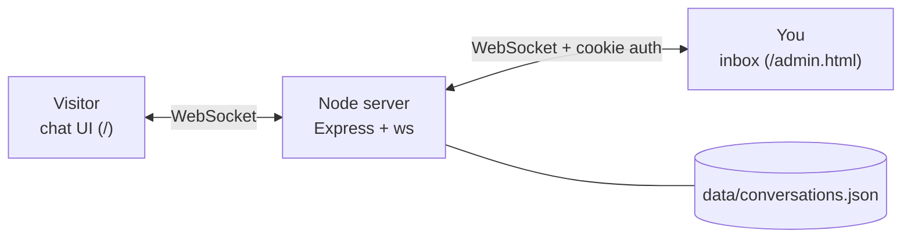
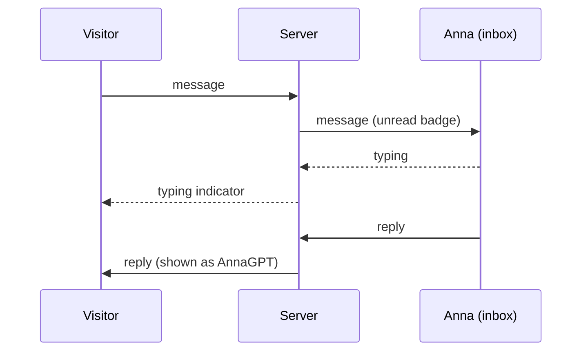
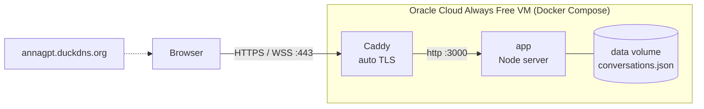

# AnnaGPT

```
(
    )
c[_]
```

A ChatGPT-style chat interface where the replies come from a real person. Visitors chat in the familiar UI; messages land in a private inbox where you answer them in real time.

Live at <https://annagpt.duckdns.org> (inbox: <https://annagpt.duckdns.org/admin.html>).

## How it works





## Run it

Requires Node 22+.

```sh
npm install
cp .env.example .env   # set ADMIN_PASSWORD
npm start
```

- Visitor chat: <http://localhost:3000>
- Your inbox: <http://localhost:3000/admin.html>

## Deployment (live 24/7)



Current setup: Ubuntu 22.04 Minimal on `VM.Standard.E2.1.Micro`, DuckDNS subdomain, containers set to `restart: unless-stopped`.

### Free: Oracle Cloud Always Free VM

`docker-compose.yml` runs the app plus [Caddy](https://caddyserver.com), which gets a free HTTPS certificate automatically. HTTPS is required in production because the admin cookie is `Secure`.

1. **Create the VM.** In Oracle Cloud, create a Compute instance with Ubuntu and an "Always Free" shape (`VM.Standard.A1.Flex` or `VM.Standard.E2.1.Micro`). In the Networking step, create a new VCN and public subnet and enable "Automatically assign public IPv4 address" (if the VM ends up without one, edit the primary VNIC's IP and add a public IP). Generate an SSH key pair, save the private key, and note the public IP.
   - Check that the VCN's route table has `0.0.0.0/0` pointing to the Internet Gateway; otherwise SSH times out.
2. **Open ports 80 and 443.** In the VCN's Default Security List, add ingress rules for TCP 80 and 443 from `0.0.0.0/0` (22 is there by default). Then on the VM:
   ```sh
   sudo apt-get update && sudo apt-get install -y rsync curl iptables-persistent
   sudo iptables -I INPUT 6 -m state --state NEW -p tcp --dport 80 -j ACCEPT
   sudo iptables -I INPUT 6 -m state --state NEW -p tcp --dport 443 -j ACCEPT
   sudo netfilter-persistent save
   ```
3. **Get a free domain.** Create a subdomain at [duckdns.org](https://www.duckdns.org) and point it to the VM's public IP.
4. **Install Docker** on the VM:
   ```sh
   curl -fsSL https://get.docker.com | sh && sudo usermod -aG docker $USER
   ```
   Log out and back in. On the 1 GB Micro shape, add swap first so builds don't run out of memory:
   ```sh
   sudo fallocate -l 2G /swapfile && sudo chmod 600 /swapfile && sudo mkswap /swapfile && sudo swapon /swapfile
   echo '/swapfile none swap sw 0 0' | sudo tee -a /etc/fstab
   ```
5. **Copy the project** (without `node_modules`) and set the password without putting it in a command line:
   ```sh
   chmod 600 ~/.ssh/<key>
   rsync -az -e "ssh -i ~/.ssh/<key>" --exclude node_modules --exclude data --exclude .env --exclude .git ./ ubuntu@<vm-ip>:~/annagpt/
   read -s "pw?Admin password: "   # zsh; type it, press Enter
   printf 'ADMIN_PASSWORD=%s\nDOMAIN=yourname.duckdns.org\n' "$pw" | ssh -i ~/.ssh/<key> ubuntu@<vm-ip> 'cat > ~/annagpt/.env && chmod 600 ~/annagpt/.env'; unset pw
   ```
6. **Start it.** Containers restart automatically after reboots.
   ```sh
   ssh -i ~/.ssh/<key> ubuntu@<vm-ip> 'cd ~/annagpt && sudo docker compose up -d --build'
   ```

Update later by re-running the `rsync` and the `docker compose up -d --build` step. Conversations live in the `annagpt_data` Docker volume. View logs with `sudo docker compose logs -f app`.

### Paid alternative: Fly.io

`fly.toml` is included. Create a volume with `fly volumes create annagpt_data --size 1`, set `ADMIN_PASSWORD` with `fly secrets set`, then `fly deploy`.

Run a single instance only, since chat state lives in that process.

## Structure

```
server/
  index.js     HTTP routes, WebSocket routing between visitors and admin
  store.js     Conversations in memory, persisted to a JSON file
  auth.js      Admin login, session cookie, login rate limiting
public/
  index.html, chat.js   Visitor UI
  admin.html, admin.js  Inbox UI
  shared.js, styles.css Shared rendering, socket and styles
```

## Behavior

- Visitors get a chat history in the sidebar (stored in their browser's `localStorage`); "New chat" starts a fresh draft and the conversation is only created on the first message. On phones the sidebar opens from the menu button.
- Visitors see whether you are online and a typing indicator while you write.
- The inbox shows unread counts and syncs across multiple tabs/devices.
- Limits: 2000 characters per message, 20 messages per minute per connection.
- Messages are rendered as plain text (never HTML).

## Ideas for next steps

- Push/email/Telegram notification when a message arrives while you are offline
- Swap the JSON file for SQLite
- Delete or archive conversations from the inbox
- Back up the `annagpt_data` volume
